<div align="center">


# El7a2ny Virtual Clinic

**See a doctor from home. Keep every prescription, record and payment in one place.**

A full-stack virtual clinic for patients and doctors: book video visits, pay by wallet or card,
get stamped prescriptions, manage a family, and chat, all in one clean web app.


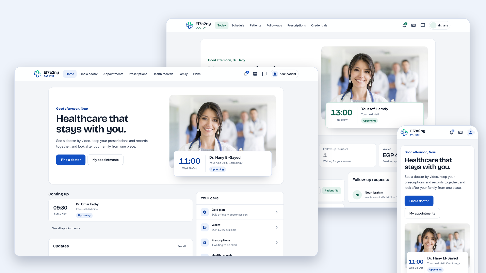

</div>

---

## Highlights

- **Two role-aware experiences.** Patients get a calm blue workspace, doctors a green one. The accent, navigation and home page adapt to who signed in.
- **Book in four steps.** Choose a doctor, pick a time, pay from the wallet or by card, meet by video.
- **Prescriptions as real documents.** A letterhead, Rx, "how to take" notes, the clinic's seal, and the pharmacy's seal once paid and filled. Download as PDF.
- **Card payments done properly.** Stripe Checkout with server-side pricing, a signed webhook and idempotent fulfilment, so a refresh or a replayed event never charges or credits twice.
- **Health plans.** Silver, Gold and Platinum discounts on sessions, medicine and family plans, applied live to every price.
- **Family and records.** Add relatives, keep health records and upload documents.
- **Wallet and notifications** for both roles, written as plain sentences ("Your visit with Dr. Hany on Wed 28 Oct, 11:00 is booked").
- **Chat** between patients and doctors (Socket.IO).
- **Responsive.** Phones get a bottom tab bar and stacked layouts instead of a squeezed desktop page.

## A look around

### Patient

| Find a doctor | Plans |
| :---: | :---: |
| 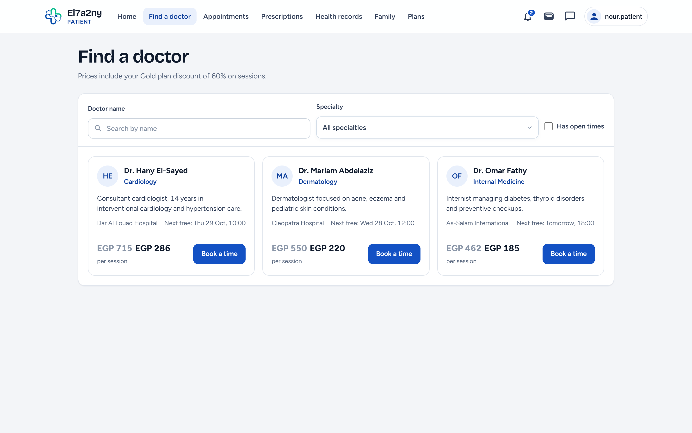 | 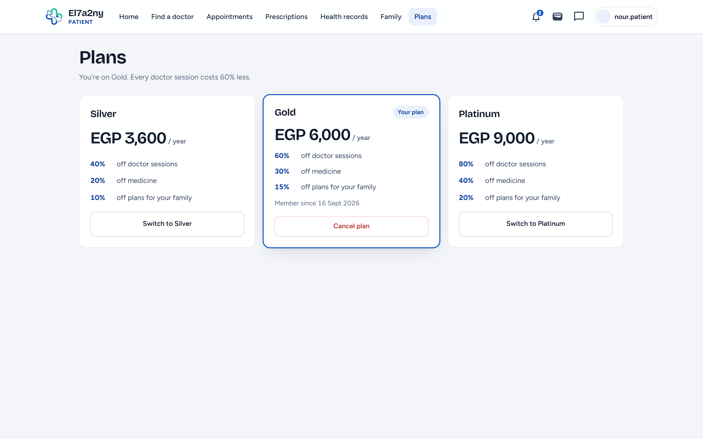 |
| **Appointments** | **Wallet** |
| 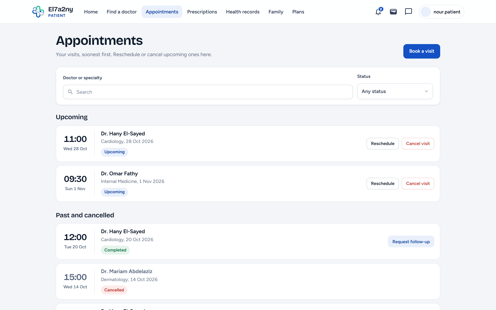 | 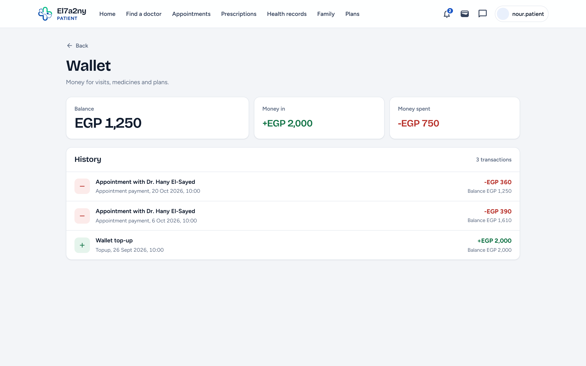 |

### The prescription

<p align="center">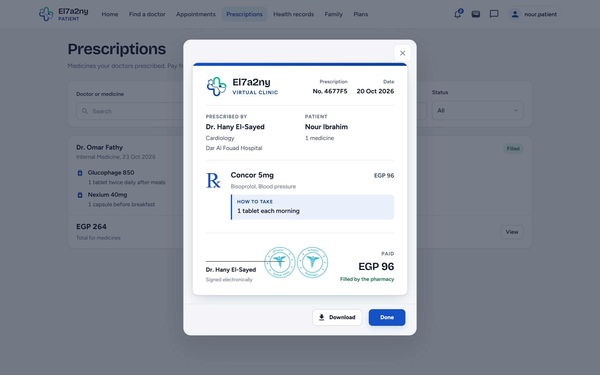</p>

### Doctor

| Patients | Prescriptions |
| :---: | :---: |
| 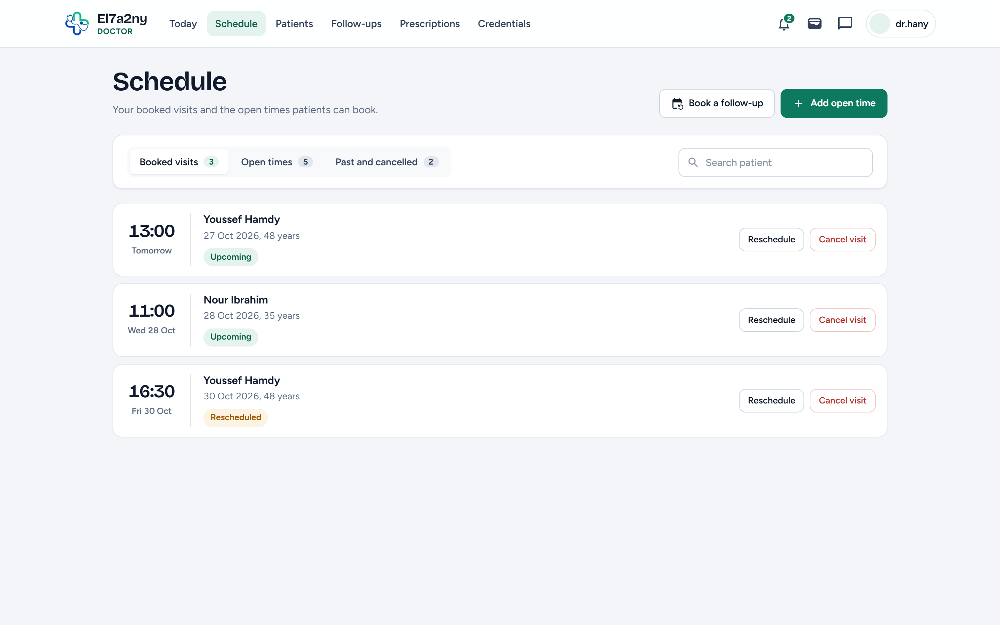 | 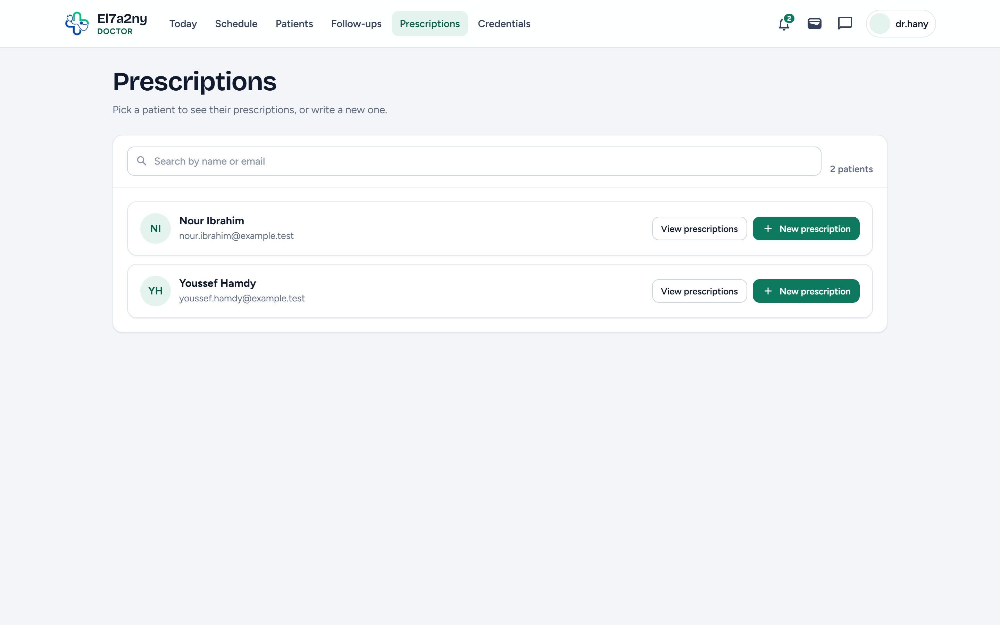 |

### On a phone

<p align="center">
  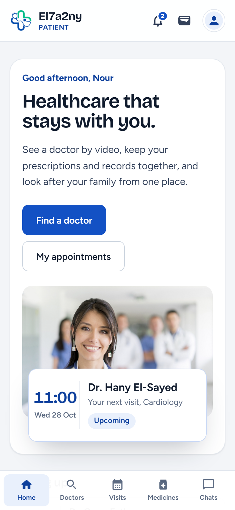
  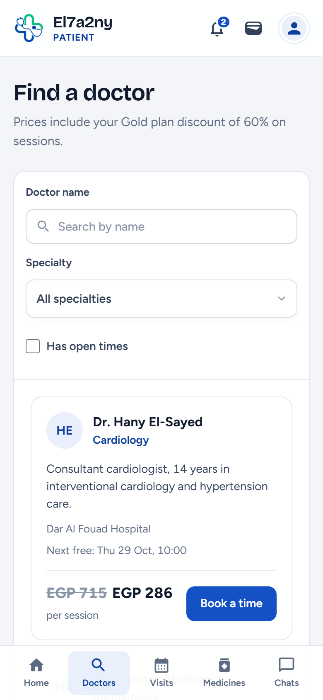
  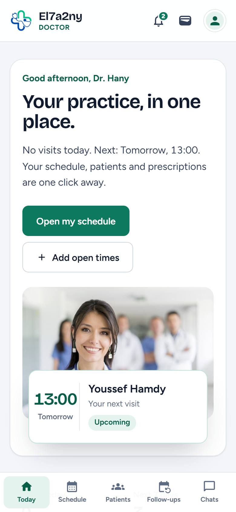
</p>

## How it fits together

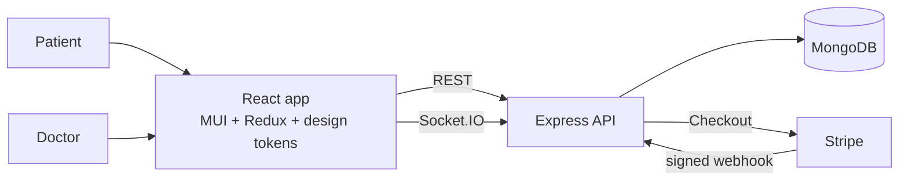

| Layer | Tech |
| --- | --- |
| Web app | React 18, Redux Toolkit, MUI 5, React Router 6, html2canvas + jsPDF |
| API | Node.js, Express, Mongoose, JWT cookies, bcrypt, Multer, Nodemailer |
| Payments | Stripe Checkout (EGP) + webhook |
| Realtime | Socket.IO chat |
| Data | MongoDB |

## Getting started

You need **Node 18+** and a **MongoDB** you can reach (local `mongod` or Atlas).

```bash
git clone https://github.com/Nardy11/Aplus-Cant-Lose-Clinic.git
cd Aplus-Cant-Lose-Clinic

# 1. Backend
cd Backend
npm install
cp .env.example .env        # then fill in the values (see below)
npm run seed                # optional: demo doctors, patients, visits and prescriptions
npm start                   # http://localhost:10000

# 2. Frontend (new terminal)
cd Frontend
npm install --legacy-peer-deps
npm start                   # http://localhost:3000
```

### Try it with demo data

`npm run seed` fills a separate local database named `AplusClinicDemo` (it refuses to touch anything else).
Start the backend against it with `MONGO_URI=mongodb://127.0.0.1:27017/AplusClinicDemo npm start`, then sign in:

| Role | Username | Password |
| --- | --- | --- |
| Patient | `nour.patient` | `Demo@1234` |
| Doctor | `dr.hany` (also `dr.mariam`, `dr.omar`) | `Demo@1234` |

### Environment variables (`Backend/.env`)

| Variable | Purpose |
| --- | --- |
| `MONGO_URI` | MongoDB connection string |
| `TOKEN_SECRET` | Secret used to sign login tokens |
| `STRIPE_PRIVATE_KEY`, `STRIPE_PUBLISHABLE_KEY` | Your Stripe keys (use `sk_test_` / `pk_test_` while developing) |
| `STRIPE_WEBHOOK_SECRET` | Optional locally. Needed in production so paid sessions are fulfilled even if the browser is closed |
| `FRONTEND_URL` | Where Stripe sends people back after paying (default `http://localhost:3000`) |
| `EMAIL`, `EMAIL_PASSWORD` | Mailbox used for reset and approval emails |

Test a card payment with Stripe's `4242 4242 4242 4242` card, any future expiry and any CVC.
To exercise the webhook locally: `stripe listen --forward-to localhost:10000/api/stripe/webhook`.

## Project layout

```
Backend/
  Models/        Mongoose schemas (users, appointments, prescriptions, Stripe payments, ...)
  Routes/        patient, doctor, admin, chat, message routers
  controllers/   request handlers and the payment flow
  scripts/       seed-demo.js
Frontend/src/
  design/        tokens.css, ui.css, shared components, formatters, MUI theme
  components/    patient/, doctor/, Adminstrator/, Authentication/, common/
docs/            API reference and screenshots
```

The API is documented in [docs/API.md](docs/API.md).

## Notes

- The administrator pages are the original ones and have not been redesigned.
- The API does not check tokens on every route yet. Add that before putting it on the public internet.

## Credits

Started as a university project by the Advanced Computer Lab 2023 team
([original repository](https://github.com/advanced-computer-lab-2023/Aplus-Cant-Lose-Clinic)),
then redesigned and extended with the shared design system, rebuilt prescriptions and verified Stripe payments.
Built with the [React](https://react.dev), [MUI](https://mui.com), [Express](https://expressjs.com),
[Mongoose](https://mongoosejs.com) and [Stripe](https://stripe.com/docs) documentation close by.

## License

[GNU GPL v3](https://www.gnu.org/licenses/gpl-3.0.txt)
